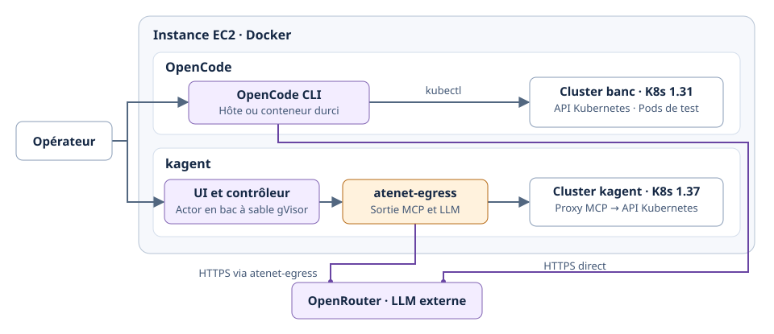
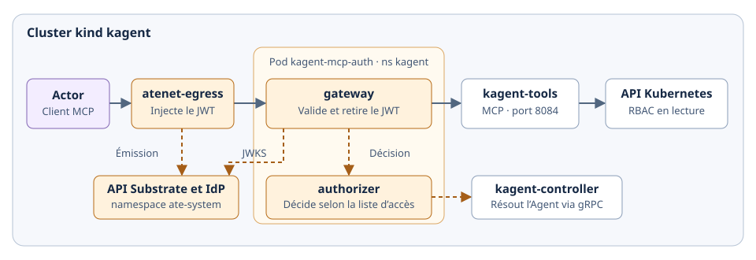

# agentic-ops

Agents IA pour l'exploitation (Ops), comparés sur un banc Kubernetes jetable :
- **OpenCode** : agent en ligne de commande sur le poste ou dans un conteneur durci, avec des agents Ops personnalisés ;
- **kagent** : agents qui tournent dans le cluster, durcis par RBAC et NetworkPolicy.

Les 2 sont testés avec le même modèle (`gpt-oss-120b` via OpenRouter) sur les mêmes pannes, avec des scripts de test
rejouables (`bench/`, `kagent/test-intrusion.sh`).

OpenCode est un agent IA open-source en ligne de commande qui peut interagir directement avec votre environnement: lire/modifier des fichiers, exécuter des commandes, analyser les erreurs et itérer jusqu'à résolution.

Sources:
- [GitHub OpenCode](https://github.com/anomalyco/opencode)
- [Deep dive technique](https://cefboud.com/posts/coding-agents-internals-opencode-deepdive/)

Termes employés (agent, sous-agent, session, permission...) : voir `termes.md` (dépôt privé). Pourquoi des agents
spécialisés (agents principaux Plan/Build, sous-agents) : voir `introduction-agents.md` (dépôt privé).

Sommaire:

- [Architecture du banc d'essai (OpenCode et kagent)](#architecture-du-banc-dessai-opencode-et-kagent)
  - [Contrôles du flux MCP dans le cluster kagent](#contrôles-du-flux-mcp-dans-le-cluster-kagent)
  - [Comparaison des deux outils](#comparaison-des-deux-outils)
- [Installation](#installation)
- [Configuration des agents Ops](#configuration-des-agents-ops)
- [Exemples d'utilisation](#exemples-dutilisation)
- [kagent : installation et exemples](#kagent--installation-et-exemples)
- [Banc d'essai et résultats](#banc-dessai-et-résultats)
- [Bonnes pratiques](#bonnes-pratiques)

## Architecture du banc d'essai (OpenCode et kagent)

Ce dépôt sert aussi de banc de comparaison entre **OpenCode** (agent sur le poste/conteneur) et **kagent** (agents dans
le cluster). Tout tourne sur **une seule instance EC2** (jetable, Spot, us-east-1), qui héberge Docker et **2 clusters
kind** indépendants. Le LLM (`gpt-oss-120b` et, pour comparaison, `gpt-4.1-mini`) est appelé chez **OpenRouter**, à
l'extérieur. Détails : `comparaison-opencode-kagent.md` (dépôt privé),
[Sécurité de kagent](docs/references/securite-kagent.md).



### Contrôles du flux MCP dans le cluster kagent



Les traits pleins suivent les appels MCP. Les pointillés montrent les consultations liées à l’identité
et à l’autorisation. `atenet-egress` et l’IdP résident dans `ate-system`. Dans `kagent`, le proxy
et `authorizer` partagent le même pod. Le proxy transmet les requêtes autorisées à `kagent-tools`.

**Flux :**
- **OpenCode** parle au cluster `banc` par `kubectl` (lecture seule via le compte `opencode-lecture` en mode conteneur),
  et au LLM par HTTPS **direct** vers OpenRouter.
- **kagent, appels d’outils** : `atenet-egress` injecte le JWT de l’Actor dans l’appel MCP. Le proxy interne
  `kagent-mcp-auth` le valide. Son conteneur d’autorisation appelle `kagent-controller` pour retrouver l’Agent
  associé, puis applique la liste d’accès. `kagent-tools` reçoit les requêtes autorisées et interroge
  l’API Kubernetes avec son compte de service.
- **kagent, raisonnement du modèle** : l'appel au LLM de l'agent sort **aussi** par `atenet-egress` vers OpenRouter,
  parce que le bac à sable force **toute** sa sortie (vers un service interne comme vers Internet) par cette passerelle.

**Filtrage et durcissement :**

| Cluster | Barrière principale | Barrière réseau |
|---------|---------------------|-----------------|
| `banc` (OpenCode) | RBAC `opencode-lecture` (lecture, sans Secrets) + conteneur durci | aucune |
| `kagent` | RBAC `kagent-tools` ramené en lecture seule sans Secrets | NetworkPolicy sur le port 8084 |

La [NetworkPolicy de kagent](kagent/hardening/networkpolicy.yaml) réserve l’accès direct à
`kagent-tools:8084` aux pods du proxy `kagent-mcp-auth`. Le proxy exige un ActorJWT valide pour l’audience
`kagent-tools-mcp` et autorise les Agents listés dans `kagent/hardening/actorjwt/allowed-agents`.

### Comparaison des deux outils

Chaque outil diagnostique les pods de test de son propre cluster. Le cluster `banc` utilise Kubernetes 1.31 et le cluster `kagent` utilise Kubernetes 1.37, la version requise par kagent 1.x dans ce banc. Chaque outil a son propre contexte `kubectl`. kagent utilise un fichier de connexion dédié.

```text
Cluster banc                  ← OpenCode interroge cette API Kubernetes
└── Namespace banc
    └── Pods de test côté OpenCode

Cluster kagent                ← kagent-tools interroge cette API Kubernetes
├── Namespace kagent
│   └── Agent et serveur d’outils kagent
└── Namespace banc
    └── Pods de test côté kagent
```

**Le nom `banc` désigne à la fois le cluster interrogé par OpenCode et un namespace présent dans chacun des deux clusters.**
Si un pod redémarre dans le namespace `banc` du cluster `kagent`, le pod de test du cluster `banc` continue de tourner indépendamment.

## Installation

```
git clone https://github.com/eazysec/agentic-ops.git
cd agentic-ops
read -rs LLM_API_KEY && export LLM_API_KEY
bash opencode/install_opencode.sh --base-url "https://api.llm:8080/v1" --proxy "<proxy_infra>:3128"
cd .. && opencode
```

Le script :
1. Installe le binaire OpenCode
2. Configure la connexion à l'API LLM
3. Déploie les agents Ops personnalisés

Variante conteneurisée et durcie (non-root, image en lecture seule, AppArmor, compte Kubernetes en lecture seule sans
Secrets) : `opencode/container/lancer.sh`, qui s'emploie comme `opencode`
(`opencode/container/lancer.sh run --agent container-ops "..."`).

## Configuration des agents Ops

Ce projet configure deux agents primaires distincts selon le périmètre d'intervention:

| Agent | Périmètre | Raccourci |
|-------|-----------|-----------|
| `container-ops` | Kubernetes, Helm, ArgoCD, observabilité applicative | Tab |
| `iaas-ops` | Terraform, Ansible, OpenStack, système, observabilité applicative | Tab |

### Sous-agents disponibles

Invocation via `@nom-agent` dans le prompt:
| Sous-agent | Usage | Appelable depuis |
|------------|-------|------------------|
| `@security-audit` | Audit de sécurité, scanning CVE, compliance | Les deux |
| `@troubleshoot` | Diagnostic de pannes, root cause analysis | Les deux |
| `@logs-analysis` | Analyse de logs, patterns d'erreurs | Les deux |
| `@iac-review` | Revue de code IaC, qualité, bonnes pratiques | Les deux |

Les sous-agents sont en lecture seule par défaut. Ils analysent et rapportent, mais ne modifient rien. C'est l'agent principal qui décide d'appliquer ou non les recommandations.

## Exemples d'utilisation

### Diagnostic d'un pod en erreur

```bash
opencode --prompt "Le pod cilium-xxx est en CrashLoopBackOff, diagnostique et propose une correction"
```

L'agent va :
1. `kubectl describe pod cilium-xxx`
2. `kubectl logs cilium-xxx --previous`
3. Analyser les erreurs (OOMKilled? Config manquante? Image introuvable?)
4. Proposer un correctif (edit du deployment ou de la configmap)

### Revue d'un role Ansible

```bash
opencode --prompt "@iac-review Analyse le role ansible nginx et vérifie les bonnes pratiques"
```

### Analyse post-incident

```bash
opencode --prompt "@logs-analysis Cherche les erreurs 4xx et 5xx dans les logs haproxy entre 14h et 15h et propose une diagnostique"
```

### Audit de sécurité

```bash
opencode --prompt "@security-audit Scanne l'image docker app:v2.1.0 et liste les CVE critiques"
```

## kagent : installation et exemples

kagent 1.x exige Kubernetes 1.37 ; sur le banc, il a son propre cluster kind et son fichier de connexion.

```bash
export KUBECONFIG=~/kagent-lab/kubeconfig
bash ./get-kagent --version v1.0.1
OPENAI_API_KEY=factice kagent install --namespace kagent
read -rs CLE && kubectl137 create secret generic kagent-openrouter -n kagent --from-literal=PROVIDER_API_KEY="$CLE"
kubectl137 apply -f kagent/hardening/rbac.yaml
docker build -t agentic-ops/kagent-mcp-authorizer:0.1.0 kagent/hardening/actorjwt/authorizer
docker save agentic-ops/kagent-mcp-authorizer:0.1.0 |
  docker exec -i kagent-control-plane ctr --namespace k8s.io images import --snapshotter overlayfs -
kubectl137 apply -k kagent/hardening/actorjwt
kubectl137 rollout status -n kagent deployment/kagent-mcp-auth
kubectl137 apply -f kagent/agents/agent-restreint.yaml -f kagent/agents/agent-gpt41.yaml
kubectl137 apply -f kagent/hardening/networkpolicy.yaml
```

Diagnostic d'un pod en erreur (le CLI passe par le contrôleur, exposé en local) :

```bash
kubectl137 port-forward -n kagent svc/kagent-controller 8083:8083 &
SID=$(kagent agent session create --agent diag-lecture-gpt41 -o json | jq -r .session.id)
kagent agent invoke --session "$SID" -o json \
  --task "Le pod oom du namespace banc redémarre en boucle. Diagnostique sans rien modifier."
```

Vérifier le durcissement : `KUBECONFIG=~/kagent-lab/kubeconfig ./kagent/test-intrusion.sh` (code 0 : un pod sans
droits ne peut pas lire un Secret par le serveur d'outils ; code 1 : risque présent). Détails :
[Sécurité de kagent](docs/references/securite-kagent.md).

Les commandes Docker supposent que l’utilisateur a accès au moteur Docker sur l’hôte du banc. L’import
`ctr` ci-dessus cible son nœud kind. Sur un autre cluster, publier l’image dans un registre autorisé et
adapter sa référence dans `proxy.yaml`.

### Fichiers nécessaires au flux ActorJWT

| Fichier | Rôle |
|---------|------|
| [`kustomization.yaml`](kagent/hardening/actorjwt/kustomization.yaml) | Point d’entrée de `kubectl137 apply -k kagent/hardening/actorjwt`. Assemble les ressources et génère la ConfigMap du proxy. |
| [`proxy.yaml`](kagent/hardening/actorjwt/proxy.yaml) | Déploie le proxy et son service interne, avec le bundle CA de Substrate. |
| [`gateway.yaml`](kagent/hardening/actorjwt/gateway.yaml) | Configure la validation JWT et le transfert des requêtes MCP vers `kagent-tools`. |
| [`server.yaml`](kagent/hardening/actorjwt/server.yaml) | Déclare le serveur MCP commun et les audiences du proxy et de la résolution d’identité. |
| [`allowed-agents`](kagent/hardening/actorjwt/allowed-agents) | Liste les Agents autorisés sous la forme namespace/nom. |
| [`authorizer/`](kagent/hardening/actorjwt/authorizer/) | Service local au proxy qui interroge `kagent-controller` et applique la liste d’accès. |
| [`kagent/agents/`](kagent/agents/) | Configure les agents qui utilisent ce serveur MCP. |
| [`networkpolicy.yaml`](kagent/hardening/networkpolicy.yaml) | Réserve l’accès direct à `kagent-tools:8084` au proxy. |
| [`rbac.yaml`](kagent/hardening/rbac.yaml) | Borne séparément les droits de `kagent-tools` auprès de Kubernetes. |

Les scripts sous [`kagent/tests/actorjwt/`](kagent/tests/actorjwt/) servent à vérifier le flux. Ils s’exécutent à la demande.

### Vérification ActorJWT

Depuis l’EC2, avec le kubeconfig du cluster `kagent` et un pod de test dans le namespace `banc` :

```bash
export KUBECONFIG="$HOME/kagent-lab/kubeconfig"
./kagent/tests/actorjwt/test-actorjwt-state.sh
./kagent/tests/actorjwt/test-actorjwt-session.sh diag-lecture-gpt41
./kagent/tests/actorjwt/test-actorjwt-session.sh diag-lecture
./kagent/tests/actorjwt/test-actorjwt-network.sh
```

Le test de session vérifie la réponse de l’outil et la trace d’authentification du proxy. Pour vérifier les refus
sans utiliser de jetons réels, lancer le [test du proxy](kagent/tests/actorjwt/test-actorjwt-proxy.py) avec Python 3, OpenSSL et Docker :

```bash
image=$(awk '/^[[:space:]]*image:/ {print $2; exit}' kagent/hardening/actorjwt/proxy.yaml)
python3 kagent/tests/actorjwt/test-actorjwt-proxy.py "$image" 18180
```

Pour vérifier le refus d’un Agent authentifié, appliquer temporairement le
[manifeste témoin](kagent/tests/actorjwt/agent-authz-witness.yaml), lancer
`MCP_EXPECT=deny ./kagent/tests/actorjwt/test-actorjwt-session.sh diag-authz-witness`, puis supprimer
les ressources du témoin avec `kubectl137 delete -f kagent/tests/actorjwt/agent-authz-witness.yaml`.
Le test attend un HTTP 403 dans les traces du proxy pour l’Actor de cette session.

### Ajouter un Agent autorisé

1. Dans son `AgentTemplate`, référencer le `RemoteMCPServer` `kagent-tools-authenticated` et indiquer
   les outils que l’agent doit demander.
2. Ajouter son identité `namespace/nom` à [`allowed-agents`](kagent/hardening/actorjwt/allowed-agents).
3. Depuis la racine du dépôt, avec le kubeconfig du cluster `kagent`, appliquer la politique et attendre
   le remplacement du pod :

   ```bash
   kubectl137 apply -k kagent/hardening/actorjwt
   kubectl137 -n kagent rollout status deployment/kagent-mcp-auth
   ```

4. Ouvrir une nouvelle session et vérifier le résultat d’un appel MCP. Pour retirer l’accès, supprimer
   la ligne correspondante, réappliquer et vérifier le refus dans une nouvelle session.

### Changer la logique de décision

[`authorizer/main.go`](kagent/hardening/actorjwt/authorizer/main.go) porte la logique de décision.
Il résout l’identité de l’Agent auprès de `kagent-controller` et applique la liste d’accès. Pour
modifier cette règle, écrire le cas attendu dans [`main_test.go`](kagent/hardening/actorjwt/authorizer/main_test.go),
modifier `main.go`, puis lancer `go test ./...` depuis `kagent/hardening/actorjwt/authorizer/`.
Construire l’image avec un nouveau tag, la rendre accessible au cluster, reporter ce tag dans
`proxy.yaml`, puis appliquer les manifestes et rejouer les cas autorisé et refusé. Un changement
de la liste seule prend effet au redéploiement du pod, avec la même image.

Pour adapter
le montage à un autre cluster, vérifier l’audience MCP commune à `server.yaml` et `gateway.yaml`, conserver
`kagent-agent-info` dans `server.yaml`,
puis adapter les noms DNS, l’émetteur, le JWKS et le bundle CA dans [les manifestes ActorJWT](kagent/hardening/actorjwt/).
Les sessions ouvertes avant la migration peuvent conserver l’ancienne révision. Ouvrir une nouvelle session pour
vérifier la bascule.

## Banc d'essai et résultats

`bench/driver.sh` monte le banc étape par étape et le teste (`./driver.sh tout`, puis `./driver.sh nettoyer`).
Les pannes sont dans `bench/scenarios/outages.yaml`, les tests dans `bench/scenarios/tests.txt`.

```bash
cd bench
./driver.sh conteneur
MODE=conteneur FILTRE=diag-oom ./driver.sh tests
./repeat.sh obs-deleg-auto 3 essai1
```

Observations :
- même modèle `gpt-oss-120b` : diagnostic OOM réussi par OpenCode (outil shell) ; kagent boucle sur son outil
  structuré (93 appels mal formés sur 94) ; avec `gpt-4.1-mini`, kagent réussit 3/3. L'écart vient de l'ajustement
  entre le modèle et le schéma de l'outil ;
- les permissions d'OpenCode ne suffisent pas (`kubectl get all,secrets` contourne la règle sur les Secrets) : seul le RBAC du cluster tient ;
- l'installation par défaut de kagent expose un serveur d'outils administrateur du cluster sans authentification ;
  RBAC + NetworkPolicy le corrigent (`test-intrusion.sh`).

---

## Bonnes pratiques

**Commun**

1. Mettre la sécurité dans le RBAC du cluster (lecture seule, pas d'accès aux Secrets) : les permissions dans la configuration de l'agent se contournent.
2. Vérifier chaque protection par un test qui doit échouer (`./driver.sh conteneur`, `kagent/test-intrusion.sh`).
3. Tester le couple modèle + outils avant de choisir un modèle, et rejouer le test plusieurs fois.
4. Demander un diagnostic sans modification, puis appliquer le correctif soi-même.

**OpenCode**

5. Lancer OpenCode dans le conteneur durci dès qu'il touche un cluster.
6. Nommer le sous-agent dans la consigne quand la délégation doit être certaine.

**kagent**

7. Appliquer `kagent/hardening/` avant le premier agent : par défaut, le serveur d'outils est administrateur du cluster et sans authentification.
8. Valider les sessions sur le proxy ActorJWT avant de réserver l’accès au port 8084 aux pods du proxy.
